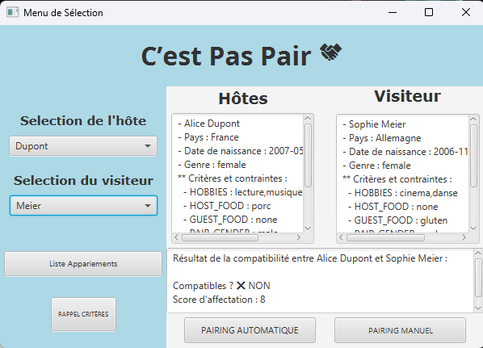

# 🧩 C’est Pas Pair – Application IHM de mise en relation Hôte / Visiteur

## 👥 Membres du groupe

Les membres ayant effectivement travaillé sur la partie IHM :

- **Enzo Dewame**
- **Emile Camard**
- **Elyas Rabhiu**

---

## 🖼️ Capture d’écran de l’application

---

## 🔗 Lien vers les mockups Figma

[Accéder aux maquettes Figma](https://www.figma.com/design/cdyXeW6Ki0eleJpARiD1Ik/Untitled?node-id=5-1230&t=1ful2NWyRru8ILkK-0)  

---

## 🎯 Justification des choix de conception (Critères ergonomiques – Théories de la Gestalt)

Notre conception s’est appuyée sur les principes de la **Gestalt** pour maximiser l’efficacité et la lisibilité de l’interface :

### 1. **Principe de proximité**
Les éléments liés fonctionnellement sont regroupés visuellement :
- Sélection de l’hôte et du visiteur dans des cadres proches.
- Résultat de la compatibilité juste en dessous, dans un champ unifié.

### 2. **Principe de similarité**
- Les listes des hôtes et des visiteurs utilisent le même style pour renforcer leur correspondance.
- Les boutons d’action (Pairing automatique / manuel) sont côte à côte et du même style.

### 3. **Principe de continuité**
- Le sens de lecture est naturel : de gauche à droite (hôte → visiteur), puis de haut en bas (sélection → résultat → action).

### 4. **Principe de figure/fond**
- Le fond bleu clair permet de bien détacher les éléments interactifs (blancs ou gris) pour faciliter la concentration de l’utilisateur.

### 5. **Conventions respectées**
- Menus déroulants pour choisir les participants, boutons clairement identifiés.
- Résultats affichés immédiatement après action de l’utilisateur.

---

## 🤝 Répartition du travail & compétences mobilisées

| Membre           | Rôle principal                                  | Compétences mises en œuvre                                       |
|------------------|--------------------------------------------------|------------------------------------------------------------------|
| Enzo Dewame    | Mise en place des maquettes basse fidelité via Figma et haute fidelité via SceneBuilder  | Ergonomie,JavaFX, Figma, SceneBuilder  |
| Emile Camard    | Mise en place des controlleurs des fichiers en .fxml   |  JavaFX, SceneBuilder, fichier FXML, liaison code     |
| Elyas Rabhiu   | Mise en place des fonctions.    | JavaFX, gestion d’événements, liaison POO / IHM       |

Nous avons exploité les forces de chacun :
- Enzo a guidé la structure visuelle en respectant les principes ergonomique.
- Elyas a élaboré le système de compatibilité basé sur les contraintes saisies.
- Emile a assuré le bon fonctionnement de l’ensemble dans JavaFX.

Une bonne communication en continu nous a permis de diviser les tâches efficacement, tout en itérant ensemble sur les retours reçus.

---

## 🎥 Vidéo de présentation

[Voir la vidéo de présentation (2-3 minutes)](eee.mp4)
Remarque : il est possible que la vidéo s'affiche sans son du a l'intégration, si c'est le cas, pour la visionner veuillez passer par le dossier fournis et non le rapport.md.

Cette vidéo présente :
- Le but de l'application.
- Une démonstration des principales fonctionnalités.

---

## 📝 Informations complémentaires

- L’application a été conçue avec **JavaFX**.
- Une attention particulière a été portée à l’**accessibilité**, la **cohérence visuelle** et la **fluidité des interactions**.

---

